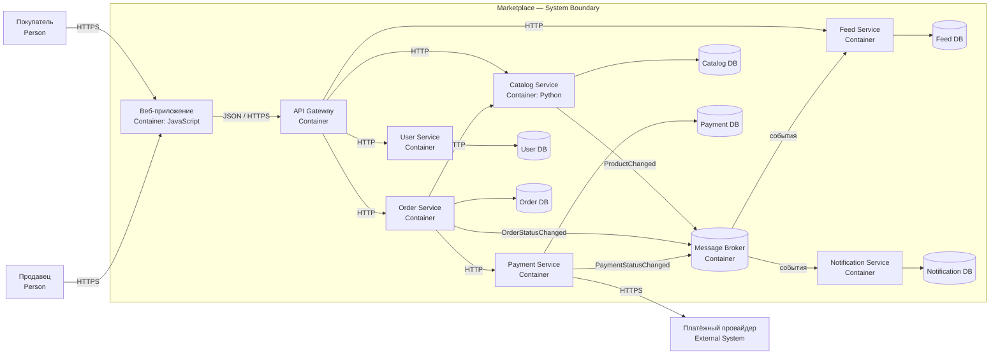

# Маркетплейс

Учебный проект архитектуры маркетплейса. Бизнес-логика пока не реализована: в репозитории поднят только каркас сервиса каталога с `GET /health`.

## Архитектура

Выбран вариант с микросервисами, разделёнными по бизнес-доменам. Пользователь работает через веб-приложение и API Gateway. Обычные запросы выполняются синхронно по HTTP, а изменения статусов и данные для ленты передаются асинхронно через брокер сообщений.

### C4 Container



Исходник отдельной диаграммы: [`docs/c4-container.puml`](docs/c4-container.puml).

## Домены и владение данными

| Домен / сервис | Ответственность | Собственные данные |
|---|---|---|
| User Service | покупатели, продавцы, профили и роли | пользователи, роли, настройки |
| Catalog Service | создание и изменение карточек товаров продавцами | товары, категории, цены, остатки |
| Feed Service | выдача ленты, простая персонализация по категориям прошлых заказов | подготовленные ленты, предпочтения категорий |
| Order Service | корзина, оформление заказа, статусы заказа | корзины, заказы, позиции заказа |
| Payment Service | расчёт суммы, проведение и учёт платежей | платежи, возвраты, платёжные статусы |
| Notification Service | отправка уведомлений о статусе заказа | шаблоны, история и статус отправки |

Каждый сервис изменяет только свою базу. Общих баз данных нет. Разбиение сделано по бизнес-ответственности: изменения каталога, заказов, платежей и уведомлений можно выпускать независимо, а платёжные данные изолированы.

## Взаимодействия

| Откуда → куда | Способ | Назначение |
|---|---|---|
| Web → API Gateway → сервисы | синхронно, HTTP/JSON | пользовательские команды и запросы |
| Order Service → Catalog Service | синхронно, HTTP/JSON | проверка товара, цены и остатка |
| Order Service → Payment Service | синхронно, HTTP/JSON | создание платежа |
| Catalog Service → Feed Service | асинхронно, событие `ProductChanged` | обновление данных ленты |
| Order Service → Feed Service | асинхронно, событие `OrderStatusChanged` | учёт категорий завершённых заказов |
| Order/Payment Service → Notification Service | асинхронно через брокер | уведомления о новых статусах |

Асинхронные события уменьшают связанность: заказ не ждёт построения ленты или отправки уведомления.

## Варианты декомпозиции

### 1. Модульный монолит

Все домены находятся в одном приложении, но разделены на модули.

Плюсы: проще запуск, тестирование и транзакции; меньше сетевых вызовов.  
Минусы: всё приложение разворачивается целиком; ошибка или высокая нагрузка одного модуля влияет на остальные; сложнее независимо развивать домены.

### 2. Микросервисы по доменам

Каждый домен реализован отдельным сервисом со своей базой.

Плюсы: независимое развёртывание и масштабирование; изоляция платёжных данных; границы ответственности совпадают с доменами.  
Минусы: сложнее эксплуатация; появляются сетевые ошибки, задержки и eventual consistency; нужны брокер и наблюдаемость.

### Финальный выбор

Выбран второй вариант. В задании явно требуется спроектировать сервисы и границы владения данными, а домены каталога, заказов, платежей и уведомлений достаточно самостоятельны. Цена выбора — дополнительная сложность распределённой системы, но для текущего этапа реализуется только один минимальный сервис без бизнес-логики.

## Запуск

Требуется Docker.

```bash
docker build -t marketplace-catalog .
docker run --rm -p 8080:8080 marketplace-catalog
```

Проверка в другом терминале:

```bash
curl -i http://localhost:8080/health
```

Ответ:

```text
HTTP/1.0 200 OK
Content-Type: application/json

{"status":"ok"}
```
