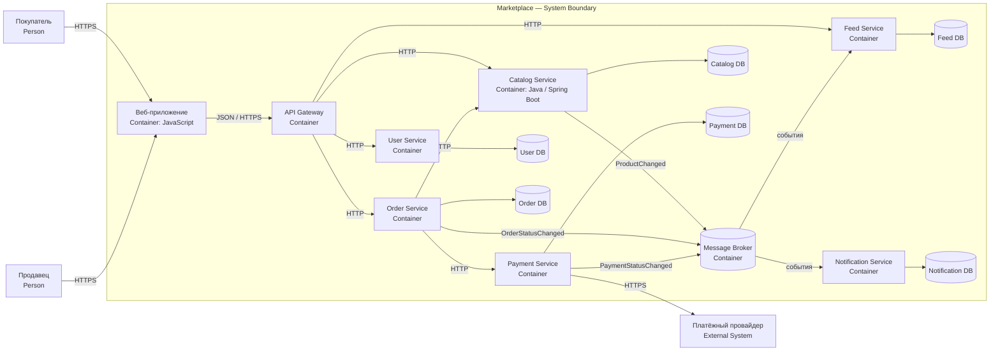

# Маркетплейс

Учебный проект маркетплейса: C4-архитектура из ДЗ1 и контрактный REST API из ДЗ2.

Стек ДЗ2: Java 21, Spring Boot, PostgreSQL, Flyway, JWT и OpenAPI Generator. Контроллеры и DTO генерируются из [`api.yaml`](src/main/resources/openapi/api.yaml) при каждой сборке и не хранятся в Git.

Диаграмма ниже показывает целевую декомпозицию из ДЗ1. В ДЗ2 каталог, заказы, авторизация и промокоды реализованы одним учебным приложением: по условию резервирование остатков и создание заказа должны проходить в одной локальной транзакции.

## Архитектура

Выбран вариант с микросервисами, разделёнными по бизнес-доменам. Пользователь работает через веб-приложение и API Gateway. Обычные запросы выполняются синхронно по HTTP, а изменения статусов и данные для ленты передаются асинхронно через брокер сообщений.

### C4 Container



Исходник отдельной диаграммы: [`docs/c4-container.puml`](docs/c4-container.puml).

## Домены и владение данными

| Домен / сервис | Ответственность | Собственные данные |
|---|---|---|
| User Service | покупатели, продавцы, профили и роли | пользователи, роли, настройки |
| Catalog Service | создание и изменение карточек товаров продавцами | товары, категории, цены, остатки |
| Feed Service | выдача ленты, простая персонализация по категориям прошлых заказов | подготовленные ленты, предпочтения категорий |
| Order Service | корзина, оформление заказа, статусы заказа | корзины, заказы, позиции заказа |
| Payment Service | расчёт суммы, проведение и учёт платежей | платежи, возвраты, платёжные статусы |
| Notification Service | отправка уведомлений о статусе заказа | шаблоны, история и статус отправки |

Каждый сервис изменяет только свою базу. Общих баз данных нет. Разбиение сделано по бизнес-ответственности: изменения каталога, заказов, платежей и уведомлений можно выпускать независимо, а платёжные данные изолированы.

## Взаимодействия

| Откуда → куда | Способ | Назначение |
|---|---|---|
| Web → API Gateway → сервисы | синхронно, HTTP/JSON | пользовательские команды и запросы |
| Order Service → Catalog Service | синхронно, HTTP/JSON | проверка товара, цены и остатка |
| Order Service → Payment Service | синхронно, HTTP/JSON | создание платежа |
| Catalog Service → Feed Service | асинхронно, событие `ProductChanged` | обновление данных ленты |
| Order Service → Feed Service | асинхронно, событие `OrderStatusChanged` | учёт категорий завершённых заказов |
| Order/Payment Service → Notification Service | асинхронно через брокер | уведомления о новых статусах |

Асинхронные события уменьшают связанность: заказ не ждёт построения ленты или отправки уведомления.

## Варианты декомпозиции

### 1. Модульный монолит

Все домены находятся в одном приложении, но разделены на модули.

Плюсы: проще запуск, тестирование и транзакции; меньше сетевых вызовов.  
Минусы: всё приложение разворачивается целиком; ошибка или высокая нагрузка одного модуля влияет на остальные; сложнее независимо развивать домены.

### 2. Микросервисы по доменам

Каждый домен реализован отдельным сервисом со своей базой.

Плюсы: независимое развёртывание и масштабирование; изоляция платёжных данных; границы ответственности совпадают с доменами.  
Минусы: сложнее эксплуатация; появляются сетевые ошибки, задержки и eventual consistency; нужны брокер и наблюдаемость.

### Финальный выбор

Выбран второй вариант. В задании явно требуется спроектировать сервисы и границы владения данными, а домены каталога, заказов, платежей и уведомлений достаточно самостоятельны. Цена выбора — дополнительная сложность распределённой системы, но для текущего этапа реализуется только один минимальный сервис без бизнес-логики.

## Реализованное API

- `POST /auth/register`, `POST /auth/login`, `POST /auth/refresh`;
- CRUD товаров с пагинацией, фильтрацией и мягким удалением;
- `POST /orders`, `GET/PUT /orders/{id}`, `POST /orders/{id}/cancel`;
- создание промокодов;
- JWT access/refresh tokens и роли `USER`, `SELLER`, `ADMIN`;
- резервирование остатков и заказы в одной транзакции;
- снимок цены товара в позиции заказа;
- процентные и фиксированные скидки;
- rate limit операций с заказом;
- единый формат ошибок и JSON-логи с `X-Request-Id`.

## Запуск

Требуется Docker.

```bash
docker compose up --build
```

После запуска:

- health-check: <http://localhost:8080/health>;
- Swagger UI: <http://localhost:8080/swagger-ui/index.html>;
- OpenAPI: <http://localhost:8080/openapi/api.yaml>;
- PostgreSQL доступен на порту `5433`.

Проверка health-check:

```bash
curl -i http://localhost:8080/health
```

Ожидаемый ответ: `200 OK` и `{"status":"ok"}`.

## E2E-сценарий

Зарегистрировать продавца и покупателя:

```bash
curl -X POST http://localhost:8080/auth/register \
  -H 'Content-Type: application/json' \
  -d '{"username":"seller","password":"password123","role":"SELLER"}'

curl -X POST http://localhost:8080/auth/register \
  -H 'Content-Type: application/json' \
  -d '{"username":"buyer","password":"password123","role":"USER"}'
```

Получить токены (нужен `jq`):

```bash
SELLER_TOKEN=$(curl -s -X POST http://localhost:8080/auth/login \
  -H 'Content-Type: application/json' \
  -d '{"username":"seller","password":"password123"}' | jq -r '.access_token')

BUYER_TOKEN=$(curl -s -X POST http://localhost:8080/auth/login \
  -H 'Content-Type: application/json' \
  -d '{"username":"buyer","password":"password123"}' | jq -r '.access_token')
```

Создать товар:

```bash
curl -X POST http://localhost:8080/products \
  -H "Authorization: Bearer $SELLER_TOKEN" \
  -H 'Content-Type: application/json' \
  -d '{"name":"Наушники","description":"Беспроводные","price":100,"stock":10,"category":"Электроника","status":"ACTIVE"}'
```

Из ответа нужно подставить `id` товара в запрос заказа:

```bash
curl -X POST http://localhost:8080/orders \
  -H "Authorization: Bearer $BUYER_TOKEN" \
  -H 'Content-Type: application/json' \
  -d '{"items":[{"product_id":"PRODUCT_UUID","quantity":2}]}'
```

Показать данные в PostgreSQL:

```bash
docker compose exec db psql -U marketplace -d marketplace
```

```sql
SELECT id, name, price, stock, status, seller_id FROM products;
SELECT id, user_id, status, total_amount, discount_amount FROM orders;
SELECT order_id, product_id, quantity, price_at_order FROM order_items;
SELECT code, current_uses FROM promo_codes;
SELECT user_id, operation_type, created_at FROM user_operations;
```

## Генерация кода

Одна команда без установленного Java и Maven:

```bash
docker run --rm -v "$PWD":/app -w /app \
  maven:3.9.11-eclipse-temurin-21-alpine mvn generate-sources
```

Результат создаётся в `target/generated-sources/openapi/`. Папка добавлена в `.gitignore` и также генерируется командой `docker compose up --build`.

## Настройки

- `ORDER_LIMIT_MINUTES` — интервал между однотипными операциями с заказом, по умолчанию `1`;
- `JWT_SECRET` — секрет подписи токенов;
- access token живёт 20 минут, refresh token — 14 дней.
